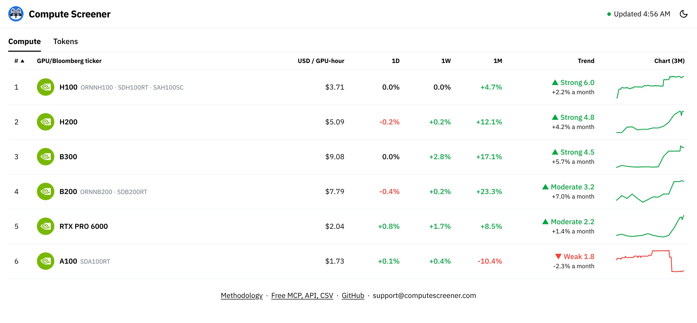

<p align="center">
  <a href="https://computescreener.com"></a>
</p>

<h1 align="center">Compute Screener</h1>

<p align="center">
  <b>Free daily price indices for renting GPUs and for AI model tokens.</b><br>
  <a href="https://computescreener.com"><b>computescreener.com</b></a>
</p>

<p align="center">
  <a href="https://computescreener.com"></a>
</p>

## What it tracks

- **GPU rental prices:** a daily index in USD per GPU-hour for **H100, H200, A100, B200, B300, RTX PRO 6000, L40S, RTX A6000, RTX 6000 Ada, L40 and RTX 4090** (L40S and RTX A6000 from 2026-10-28, RTX 6000 Ada, L40 and RTX 4090 from 2026-10-30), and each GPU added later once a whole day of collection prices it at 5 providers ([data/families.json](https://computescreener.com/data/families.json) lists every family and the day it starts; the verifier reads it). It is built from the posted on-demand prices of 20 sources (cloud rate cards and GPU marketplaces), standardized to one benchmark contract (on-demand, 8-GPU node, US), and recalculated every minute (each source read every 1 to 30 minutes). With 1-day, 1-week and 1-month changes, each provider's average price, and the prices of GPU rental contracts on the exchanges that list them.
- **AI token prices:** a daily index in USD per 1M tokens (Token Price Index 2.0, from 2026-10-28: each model's posted prices at a cache-heavy mix of 87% cache reads, 12% input and 1% output, weighted by its usage on OpenRouter) for **Anthropic, OpenAI, Google, xAI, Meta, Moonshot AI, Alibaba, DeepSeek, Z.ai, Xiaomi, StepFun, MiniMax, Mistral and NVIDIA**, with each company's models, their posted prices and the company's estimated spend on OpenRouter. History from 2025-01-01, recomputed with 2.0; version 1 (3 input : 1 output) stays downloadable.
- **Every AI model's API price:** [computescreener.com/models](https://computescreener.com/models) lists every AI model OpenRouter lists with a price (over 300 models from over 50 companies), at its maker's own price, or the median of the providers serving it when the maker does not, per 1M tokens of input, cache read and output, updated every day. Each model in the token index also has its own page with its daily price history, for example [Kimi K3](https://computescreener.com/models/kimi-k3) or [Claude Opus 5.5](https://computescreener.com/models/claude-opus-5-5).
- **Every other GPU's posted prices:** [computescreener.com/gpus](https://computescreener.com/gpus) gives the lowest, median and highest posted on-demand price per GPU-hour of over 80 more GPUs (RTX 5090, RTX 4090, RTX 6000 Ada and others), as posted and not standardized.

How every price is collected, filtered and combined: [methodology](https://computescreener.com/methodology).

## Verify every value

[](https://github.com/renshuBTC/compute-screener/actions/workflows/verify.yml)

Every final day has a manifest: each file the day was computed from with its SHA-256, and the final values. The
calculation code and a verifier are in [verify/](verify). It recomputes any published value from the public files:

```sh
python verify/verify.py --date 2026-10-25 --gpu H100
```

A job in this repository recomputes every day with a manifest, every day: [results](verify/results.csv).

## Free MCP, API and CSV

No account or key.

| | How |
| --- | --- |
| MCP (Claude, ChatGPT and other AI apps) | Add the connector `https://computescreener.com/mcp`. Setup: [computescreener.com/connect](https://computescreener.com/connect) |
| API (JSON) | Docs: [computescreener.com/api](https://computescreener.com/api) · [index.json](https://computescreener.com/data/index.json) (latest GPU prices) · [series.json](https://computescreener.com/data/series.json) (GPU history) · [tokens.json](https://computescreener.com/data/tokens.json) · [token_series.json](https://computescreener.com/data/token_series.json) · [models.json](https://computescreener.com/data/models.json) (model prices and history) · [token_market.json](https://computescreener.com/data/token_market.json) (every AI model's price) · [gpu_market.json](https://computescreener.com/data/gpu_market.json) (every other GPU's posted prices) |
| CSV (this repo) | [data/](data): every GPU's and company's daily index, provider averages, and each model's daily input and output prices, updated every day |

The connector is listed in Claude's connector directory and in the official MCP Registry as `com.computescreener/compute-screener`.

## This repository

`data/` holds the daily CSV copies (see [data/README.md](data/README.md)), refreshed by a scheduled workflow.
`verify/` holds the GPU index's calculation code and the verifier. `dist/` holds a minified build of the website's
pages, for reference. The price collectors and the connector are not published.

## Licence

- **Data:** [CC BY 4.0](https://creativecommons.org/licenses/by/4.0/). Reuse it, including commercially, with credit to "Compute Screener (computescreener.com)". See the [terms](https://computescreener.com/terms).
- **Code:** © 2026 Compute Screener. All rights reserved: no licence is granted to copy, modify or redistribute it. See [LICENSE](LICENSE).
  The code in `verify/` may be read, copied and run to check or reproduce the published values: see [verify/LICENSE](verify/LICENSE).

Prices are information about posted prices.

## Contact

[computescreener.com/support](https://computescreener.com/support) · [@RenshuBTC](https://x.com/RenshuBTC) on X
